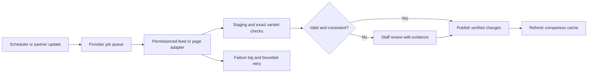

# Monj functionality review and ED comparison platform plan

Prepared: 14 September 2026. Reference reviewed: [monj.co.uk](https://monj.co.uk/), the URL supplied in the request.

Expanded on 14 September 2026 to cover commercial viability, provider discovery, data acquisition, refresh frequency and operating failures. For the business questions start at **2.8–2.11**; for automatic listings and prices start at **4.1–4.7**. All proposed intervals, commercial calculations and operating targets below are our design assumptions, not disclosures of Monj's private systems.

The two supplied Compass research documents have also been reviewed. Their useful source-discovery proposals are incorporated below; see [research reconciliation and source corrections](pharmacy-discovery-research-review.md) for what was adopted, corrected or left unverified. The original research files are preserved.

**2026-09-16 — read as the ED vertical's design record, not the whole product:** the client has since redirected the strategy to a multi-vertical platform (ED + weight-loss, more later; brand/domain is the unit, not a fixed condition). See [`milestones/00-platform-strategy.md`](milestones/00-platform-strategy.md) for the pivot and [`milestones/01-scope-and-compliance.md`](milestones/01-scope-and-compliance.md) for the per-vertical compliance framework it required. Everything below is preserved unchanged as the ED vertical's own plan, per this document's own convention of staying the historical record while `milestones/*.md` tracks live status.

## 1. Recommended product

Build a UK-focused ED information and pharmacy comparison website first. Visitors should be able to understand treatment categories, compare equivalent products and provider services, check the evidence behind listings, and continue to the chosen pharmacy for assessment and purchase.

Monj explicitly describes itself as an independent comparison service, not a pharmacy or prescriber. Its core journey does not require us to build patient records, prescriptions, payments or delivery operations. Those belong to a separate clinical-service expansion. [Source: Monj independence statement](https://monj.co.uk/about-monj-find-mounjaro-discounts/independence-statement/)

This document is the comparison-first plan. The existing [ED treatment platform roadmap](ed-treatment-platform-roadmap.md) remains available as a broader clinical-service concept; its earlier limited-access description of Monj is superseded by this public-page review.

### Research boundaries

- **Observed:** Public page content, displayed controls, tables, links and policies inspected during this review.
- **Site claim:** Statements Monj makes about its own checking, commercial model or operations; these were not independently audited.
- **Proposed:** Our suggested ED functionality and implementation. These are not claims about Monj's internal systems.
- Public HTML was accessible for the main comparison, provider, methodology and trust pages. The tools index returned a security challenge. Linked apps, every article, clipboard behaviour and all filter combinations were not interactively tested.
- Monj's database, admin interface, source code, scraping method, analytics implementation and commercial contracts are not publicly verified. This is a broad functional inventory, not a backend audit or pixel-perfect specification.
- Assumptions: UK market, responsive website first, GBP pricing, anonymous comparison, external pharmacy purchase. English and Urdu support follows this repository's instructions; confirm launch translation scope during discovery.

## 2. What Monj does

### 2.1 Discovery and navigation

The site offers grouped navigation for prices, guides, side effects, tools, trust and related sites. Visitors can search by topic, pharmacy or dose. There are dedicated dose pages, a price-data hub, FAQs, safety links and social-sharing links. The home page presents a current price summary and a checking timestamp. The wider network includes other medicine comparison sites and a patient community link. [Source: homepage](https://monj.co.uk/)

**ED adaptation:** Use condition education, treatment information, pharmacy directory, comparison, safety and methodology sections. Create original branding and content. Weight-loss sections such as BMI, injection technique and calorie tracking do not translate directly to ED.

### 2.2 Price comparison and filters

The main list displays pharmacy prices across six strengths, review information, registration links, support/subscription indicators and offer links. Visible controls include price-mode tabs, dose selection, pharmacy search, filter reset and sorting labels. Filter groups cover provider characteristics, support, BMI policies, reviews/inspections, prescribing evidence, delivery locations/carriers, medical-history policies and payment options. The table includes sideways-scroll guidance. These are observed controls; every resulting combination was not tested. [Source: discount comparison](https://monj.co.uk/discount-mounjaro-price-list/)

**ED adaptation:** Compare medicine, brand/generic, strength, formulation, pack quantity, total cost, unit cost, supply route, delivery coverage and purchase model. Avoid using medical-history filters as an automated suitability decision. Start with service and product attributes instead.

### 2.3 Price definitions and recurring costs

Monj distinguishes discounted first-order prices from standard prices and identifies subscriptions. Its methodology describes adding relevant delivery and extras, checking product-specific conditions, and leaving unknown ongoing subscription prices blank. These are published methodology claims, not proof that every displayed amount matches checkout. [Source: pricing methodology](https://monj.co.uk/how-pricing-works/)

**ED adaptation:** Show first purchase and repeat costs separately, with the actual pack and billing interval. Unknown fees must remain unknown; they must never become a misleading zero.

### 2.4 Bundles

The bundle page offers two- or three-pen configurations, strength selectors, price-order controls and discounted/retail views. Rows show delivered totals and per-pen costs. [Source: bundle comparison](https://monj.co.uk/mounjaro-bundle-prices/)

**ED adaptation:** Compare genuine pharmacy pack sizes and published recurring plans. Do not copy dose-escalation bundles or encourage medicine combinations. Price per tablet is an arithmetic comparison, not evidence that different products or strengths are clinically interchangeable.

### 2.5 Pharmacy directory and individual pages

The directory groups providers by type and links to individual pages. Monj says it checks registration evidence before listing. [Source: pharmacy directory](https://monj.co.uk/pharmacies/)

A reviewed provider page contains offer conditions, a copy-and-visit link, checking dates, dispensing-pharmacy details, review/register links and attributed descriptions of the provider's support. Its instructions explicitly continue into the provider's assessment and ordering route. Clipboard operation was described by the page but not tested. [Source: New Health example](https://monj.co.uk/new-health-discount-codes/)

**ED adaptation:** Give each provider one page covering verified business identity, dispensing partner, supply process, prices, delivery, privacy/discreet-packaging claims, evidence dates and external website. Clearly label provider-reported claims.

### 2.6 Trust and regulatory evidence

Monj explains an inspection-based pharmacy score, distinguishes it from Trustpilot reviews, and links regulatory evidence. Registration, inspection findings and customer opinions are separate concepts; a missing published inspection is not automatically a failed inspection. [Source: pharmacy score](https://monj.co.uk/pharmacy-score/)

**ED adaptation:** Show source links, checked dates and explicit unknown states. Prefer official inspection wording to inventing a safety score. Verify the correct regulator for each provider's activity and jurisdiction rather than treating one badge as universal approval.

### 2.7 Education, tools and community

The navigation exposes treatment guides, practical information, side-effect topics, calculators, tracker-app links and a support-community link. Their presence was observed; the tools index itself was blocked, so ownership, sign-in requirements and detailed functionality of every linked tool are unverified. [Source: navigation](https://monj.co.uk/)

**ED adaptation:** Publish reviewed ED explanations, treatment-category information, pharmacy-assessment guidance and when-to-seek-help content. An optional pack-cost calculator fits the comparison model. A symptom checker, treatment diary or moderated community is a separate later feature.

### 2.8 Revenue and privacy

**Monj's stated source of income is pharmacy referral commission; it calls this its only site income.** It says participation does not buy inclusion, position or favourable descriptions. Its parent company also develops software, but describes that as a separate activity. Actual revenue, profit, commission rates, payment schedules and partner contracts were not established. The pricing-methodology page has conflicting commission wording; Monj says the independence statement takes precedence. [Sources: independence](https://monj.co.uk/about-monj-find-mounjaro-discounts/independence-statement/), [methodology](https://monj.co.uk/how-pricing-works/)

Its privacy policy describes enquiry-related email use and says it does not send marketing communications. This is a published policy, not a technical privacy audit. [Source: privacy policy](https://monj.co.uk/privacy-policy/)

**ED adaptation:** Publish our own accurate commercial disclosure. Affiliate agreements are optional and must not decide factual ranking. Accounts, newsletters, alerts and conversion dashboards are proposed additions, not established Monj parity requirements.

### 2.9 Why would a pharmacy pay when it is already listed for free?

**It may choose not to.** Listing a pharmacy does not create a commission obligation. Our platform needs an accepted affiliate agreement, either directly or through a network. Often the pharmacy already has a programme and **we apply to become its publisher**; it does not necessarily sign up to a new referral system built by us. Awin describes this advertiser/publisher structure in its [affiliate FAQ](https://www.awin.com/gb/faqs).

The following is commercial reasoning for our proposed service, not a report of Monj's negotiations:

| Pharmacy's question | Commercial answer | Limit to the argument |
| --- | --- | --- |
| Why pay for traffic I already receive? | A partnership may produce additional completed purchases through accurate deep links, current data and an approved customer offer | Attribution alone does not prove the purchase was additional; compare against a baseline |
| What am I buying? | An agreed acquisition outcome, usually an eligible attributed sale, rather than a guaranteed position | The contract must define exactly which orders qualify |
| Why not buy advertisements myself? | A comparison audience may already be actively evaluating providers; performance payment can make acquisition cost more predictable | It may still cost more than the pharmacy's existing channels |
| Can I provide an exclusive customer price? | If permitted, a lower genuine total may attract customers and rank better under the same price rule applied to everyone | Improved position comes from the customer price, never the commission rate |
| Can we supply data without paying commission? | Yes: accurate prices reduce disappointed visitors and correction work | Data sharing and affiliate participation must remain separate choices |
| Will I keep getting repeat orders? | A first acquisition might lead to repeat business retained by the pharmacy | We must not assume repeat purchases generate repeat commission |

**The free-listing problem is real:** a provider might get similar traffic without paying. The business must earn partnerships by demonstrating added value; it cannot assume every listed provider will monetise. Do not remove a legitimate low-price provider or worsen its placement to force participation. Accurate non-partner coverage is part of why users trust the comparison.

**Proposed partner offer:** free factual listing and corrections for everyone; optional feed integration and an independently reviewed referral agreement; reporting on eligible attributed orders. No paid verification badge, favourable review or ranking promise. Data cooperation must not determine how quickly equally important safety issues are handled.

### 2.10 How referrals become money, and where they fail

**Proposed commercial flow:** visitor chooses provider → approved tracked link or attributable code → provider performs its own assessment and checkout → eligible transaction reported → pending commission → validation/reversal → payable amount → settlement. An outbound click is not a purchase, and a pending commission is not money received.

| Implementation | What we build/use | Main consideration |
| --- | --- | --- |
| Existing affiliate network | Join a provider's programme; use approved links and transaction reports | Fastest where our site, exact products and activities are accepted; network access alone is insufficient |
| Direct pharmacy agreement | Contracted attribution, signed server notifications or settlement reports, reconciliation | More negotiation and integration; pharmacy must operate reliable tracking |
| Partner code with periodic reports | Code-based attribution and monthly reconciliation under explicit rules | Simple pilot if permitted; code sharing and overwritten attribution can create disputes |

Record commission basis (fixed amount or percentage), excluded fees/taxes/products, first versus returning customers, attribution window, competing-channel precedence, consent requirements, cancellation/clinical-decline rules, refunds, repeat orders, settlement timing and termination. The pharmacy controls clinical decisions; remuneration must not pressure approval.

Use opaque transaction references and aggregate commercial outcomes. Do not request patient names, questionnaire answers or reasons for a clinical decline to settle commission. Even pseudonymous event data can remain personal data: review the minimum fields, retention and contractual roles. Validate signed callbacks, deduplicate transaction IDs and support reversals so retries never double-count income. If cookies are declined or tracking is blocked, preserve access to the provider and accept attribution loss; do not introduce fingerprinting as a workaround.

**Real example, not a partner recommendation:** Click Pharmacy publicly offers an Awin programme and product feed. However, its published programme terms prohibit promotion of prescription medication and restricted weight-loss products. This demonstrates that having a pharmacy programme/feed does **not** establish permission to monetise our intended ED pages. Confirm exact product and content eligibility before forecasting revenue. [Sources: provider programme](https://www.clickpharmacy.co.uk/affiliate-program), [programme restrictions](https://ui.awin.com/merchant-profile-terms/76758)

### 2.11 Will the business earn enough to operate?

**Illustrative model only; these are invented assumptions, not Monj figures or market benchmarks.** Model eligible sale-based commission as:

`Monthly commission = qualified visits × outbound-click rate × paying-partner click share × purchase rate × eligible/tracked/validated share × net commission per approved sale`

For example: 20,000 visits × 30% outbound clicks × 50% to paying partners × 5% purchases × 80% eligible/tracked/validated × £8 commission = **£960 per month**, representing 120 approved commissionable orders. If operating costs are £2,000/month, that loses £1,040 before tax and recovery of build costs. At the same assumptions, operating break-even requires approximately **41,667 visits/month**. These figures are not a forecast.

| Change to the example | Approximate monthly commission | Why it matters |
| --- | --- | --- |
| No accepted ED affiliate agreements | £0 | A functioning comparison site can have no referral income |
| Paying-partner click share falls from 50% to 25% | £480 | The cheapest providers may be non-partners |
| Net commission falls from £8 to £4 | £480 | Smaller baskets or lower negotiated fees can change viability |
| Purchase rate rises from 5% to 10% | £1,920 | Conversion matters, but must never be improved by bypassing clinical checks |

The pharmacy has a different calculation. If a hypothetical order produces £14 contribution after medicine, clinical, fulfilment, payment and expected refund costs but before acquisition, an £8 referral fee leaves £6 before fixed overhead. A further pharmacy-funded £5 discount leaves £1. If contribution already includes the discount, do not subtract it again. The pharmacy should estimate **incremental** contribution: paying on purchases it would have received anyway can reduce profit even when attributed sales look good.

Do not apply weight-loss order economics to ED without evidence. Obtain anonymised ED order-value, net-commission and validation-rate ranges from willing partners. Forecast repeat commission only when the contract explicitly pays it; pharmacy customer lifetime value and our lifetime commission are different numbers.

**Proposed launch strategy:** fund a limited editorial/data pilot, build useful verified coverage, measure traffic and outbound interest with appropriate privacy controls, and negotiate a small number of eligible programmes. Agree an 8–12 week commercial evaluation window after launch, a monthly operating cap and a decision threshold before scaling. Useful measures are net settled revenue per qualified visit, eligible partner coverage, price accuracy and contribution after operating costs. If partners or traffic do not materialise, keep a funded information service, reduce scope, or stop expansion; do not silently convert independent ranking into paid placement. Optional future paid business tools or licensed original data would be a separate model with separate rights, not a claim about Monj.

### 2.12 Why would visitors use us, and how do we get the first audience?

The user benefit must be more than a page of pharmacy logos: show comparable pack totals, repeat costs, delivery assumptions, evidence dates and a clear route to resolve incorrect information. Cover non-partners so the service answers the user's question even when that visit earns nothing. Our defensible work is the verified provider/product mapping, dependable updates, useful original explanations and correction history; a visual copy of Monj does not reproduce these assets or its audience.

Start with a narrow set of search intents and useful reviewed pages, make them accessible to search engines, and recruit pilot feedback through channels the client already owns or has permission to use. Test approved partnerships and relevant editorial distribution once the content/commercial boundaries are agreed. Do not assume mass-generated medicine pages, paid social campaigns or a list of copied pharmacy names will produce qualified visitors. No marketing messages are being sent by this documentation task.

In the example above, commission is only **£0.048 per qualified visit** before operating costs (£960 / 20,000). Buying traffic at £0.20 per visit would lose money under those assumptions even before data operations. Measure channel-specific economics, not just page views. Search-led discovery may take longer than development; the 9–15 week delivery estimate is not a promise of traffic, partner acceptance or break-even by launch.

## 3. ED-specific scope and constraints

### Product catalogue

Use clinician-reviewed catalogue candidates such as sildenafil and tadalafil, with brand, formulation, strength and pack variants recorded separately. ED care can also involve non-medicine approaches; balanced education should not imply tablets are the only option. NHS information describes multiple treatment routes and notes sildenafil can be supplied on prescription or through a pharmacy. Verify the legal classification of each exact product rather than labelling all ED products prescription-only or all pharmacy-accessible. [Source: NHS ED overview](https://www.nhs.uk/conditions/erection-problems-erectile-dysfunction/)

### Public medicine information and promotions

The proposed site needs review of its actual pages, links, revenue arrangements and medicine classifications before publication. ASA guidance prohibits public advertising of prescription-only medicines and places restrictions on price lists and promotional language. A disclaimer or competitor example does not establish permission. Discount codes, cheapest-product headlines, affiliate calls to action and product-specific search pages are therefore conditional scope. If they cannot be approved, launch balanced condition education and provider information in the approved format instead. [Source: ASA website guidance](https://www.asa.org.uk/advice-online/health-prescription-only-medicines-websites.html)

### Privacy

Keep the first release anonymous and avoid collecting medical history. Identifiable ED preferences, enquiries or inferred health profiles can involve special-category information. Review lawful processing, retention, vendors and tracking before collecting it. Do not send health details, free-text searches or sensitive preferences into advertising pixels or affiliate URL parameters. [Source: ICO special-category guidance](https://ico.org.uk/for-organisations/uk-gdpr-guidance-and-resources/lawful-basis/special-category-data/what-is-special-category-data/)

### First-release user journey

1. Arrive on a condition-information or approved comparison page.
2. Read treatment information and the site's role.
3. Select an exact product variant or provider-service category.
4. Compare equivalent packs and transparent costs, where the approved publishing model permits.
5. Inspect provider evidence, delivery and purchase conditions.
6. Continue to the provider's website; assessment, supply decisions, payment and dispatch occur there.
7. Return to report incorrect listing information if needed.

No account, eligibility decision, checkout, prescribing portal or order tracking is required on our site for this journey.

## 4. Proposed system and operating model

### Public pages

Home; ED overview; treatment information; comparison; product/pack information; pharmacy directory; pharmacy details; guides; FAQs; safety resources; how comparisons work; commercial disclosure; contact/correction form; privacy and terms. Publish medicine-price and promotion pages only in the approved form.

### Staff roles

| Role | Responsibility |
| --- | --- |
| Catalogue editor | Update provider details, prices and evidence |
| Content reviewer | Review clinical information and approve publication |
| Administrator | Manage staff access, imports and publication history |
| Commercial manager | Manage partner agreements and aggregate referral reports |

These are proposed internal tools. Monj's own staff interface was not inspected.

### Minimum data records

| Record | Information to retain |
| --- | --- |
| Provider | Trading/legal names, website, regulator references, dispensing partner, service regions |
| Product variant | Ingredient, brand, strength, formulation, pack quantity, supply classification and source |
| Offer | Provider, exact variant, item cost, mandatory fees, delivery assumptions, availability, purchase model |
| Discount, if approved | Eligibility, value/type, affected variants, expiry, stacking rules and evidence |
| Evidence | Source URL, retrieved date, checked date, reviewer and approved status |
| Price history | Previous verified values and effective dates |
| Article | Author, reviewer, sources, language, publication/review dates and revision |
| Correction | Reported issue, assigned owner, resolution and audit record |
| Referral, if approved | Non-sensitive offer reference, destination and aggregate counts |

### Fair price calculation

`Delivered total = item price - applicable discount + delivery + mandatory consultation/prescription fees + other mandatory charges`

`Unit price = delivered total / tablet count`

Calculate monetary values in integer pence. Only subtract a discount when its conditions are satisfied, and do not add fees already included in the advertised total. Compare the same ingredient, strength, formulation, pack size and purchase conditions; show brand distinctions explicitly. Delivery assumptions must be visible. A recurring-plan figure must include quantity and billing period.

**Illustrative arithmetic only:** An eight-tablet pack costing £16 plus £3 delivery totals £19, or about £2.38 per tablet. Another equivalent pack at £18 with included delivery totals £18, or £2.25 per tablet. This demonstrates why item price alone can mislead; these are invented numbers, not pharmacy prices or treatment advice.

### Data maintenance

`Provider source → import/staff entry → validation → review exceptions → approved publication → expiry/recheck`

Start with a small verified catalogue. Record both last retrieval and last successful verification. Flag implausible changes, duplicate variants, expired offers and missing fees. Keep the last verified value with a stale label when retrieval fails, or remove it from current-price rankings after the agreed expiry threshold. A failed import must not erase the entire catalogue. Registration concerns require prompt review and suspension where appropriate.

### 4.1 Where do we get UK pharmacy listings?

There are three different datasets: **registered premises**, **consumer-facing online providers**, and **providers offering the exact ED products we compare**. Neither a premises register nor an affiliate network is a complete list of all three. Monj's directory describes the providers it tracks, not an exhaustive register of every UK pharmacy. [Source: Monj directory](https://monj.co.uk/pharmacies/)

| Source | What it actually provides | Use and limitation |
| --- | --- | --- |
| GPhC premises data | Great Britain premises identity, owner/trading name, address and registration-related fields | Registration checks for England, Scotland and Wales; no ED prices or complete website catalogue |
| PSNI register and monthly premises file | Northern Ireland registered premises | Complements Great Britain; monthly file must not replace a live registration check |
| CQC data, where relevant | Registered care providers/locations, activities and published ratings in England | Verifies relevant clinic entities; does not replace dispensing-pharmacy verification or cover all UK jurisdictions |
| NHSBSA Consolidated Pharmaceutical List and Contractor Details | England NHS contractor identities, ODS codes and contract information | Useful discovery/enrichment; exclude appliance-only contractors from medicine-provider candidates and do not assume private-only providers are covered |
| NHS ODS organisation data | Organisation IDs, status, dates, relationships and succession | Enrich NHS-linked identities and detect changes; an NHS record closing does not itself establish loss of pharmacy registration |
| Companies House | Company identity, names, status and search by industry classification | Candidate discovery and company corroboration; not a pharmacy licence or complete list of brands/sole traders |
| Provider websites and provider submissions | Trading website, ED offering, dispensing relationship, product variants and service details | Main route for building the commercial catalogue; independently check identity claims |
| Approved affiliate/data partners | Participating merchants, usable links and sometimes structured product feeds | Covers only contracted programmes and permitted products |
| Search and other directories | Candidate names and domains | Discovery leads only; confirm each fact at its original source before publishing |

**Concrete official options:** the March 2026 GPhC agreement describes CSV/XML extracts delivered through a web service, daily full extracts and weekly change lists. It lists the premises-only subscription at £400/year. Its terms restrict use to registration validation and prohibit marketing/redistribution outside the permitted purpose; third-party transfer requires permission and geographic restrictions apply. The premises fields do not include product prices or website URLs. Before purchasing, obtain confirmation that our proposed validation, hosting and public presentation fit the licence. Do not turn the feed into an outreach list or republish it as a commercial directory. [Source: GPhC March 2026 agreement, pp. 1, 4–5, 7, 11](https://assets.pharmacyregulation.org/files/2026-04/data-subscription-service-order-form-and-licence-agreement-march-26.pdf?VersionId=gEaRkuobjlhlplCuPxNZYeYRFmaP1NX6)

PSNI publishes a monthly premises file and explicitly directs readers to the live register for current checks. Confirm reuse terms; do not assume a public download is an unrestricted commercial licence. [Source: PSNI monthly register](https://psni.org.uk/pharmacies-monthly-premises-register-upload/)

CQC offers an API with daily data and downloadable directories under the Open Government Licence with attribution. It also warns that some directory changes may be delayed. Check the actual source date and applicable activity; an archived location may indicate a legal/entity change rather than a business closure. [Source: CQC data access](https://www.cqc.org.uk/about-us/transparency/using-cqc-data)

**Additional discovery sources from the supplied research:** NHSBSA's Consolidated Pharmaceutical List is a quarterly England dataset under OGL; its current resource dictionary includes ODS code, trading name, organisation name, address and contract type. The distance-selling signal should be checked in **Contractor Details**, rather than assumed to be a CPL column. This identifies NHS contract characteristics, not proof of private ED supply. [Sources: CPL](https://opendata.nhsbsa.net/dataset/consolidated-pharmaceutical-list), [current dictionary](https://opendata.nhsbsa.net/dataset/consolidated-pharmaceutical-list/resource/ce6c7ad3-a3b5-442f-bb0a-a45d7c962944), [official guidance identifying Contractor Details as a DSP source](https://www.gov.uk/government/publications/pharmaceutical-needs-assessments-information-pack/pharmaceutical-needs-assessments-information-pack-for-local-authority-health-and-wellbeing-boards)

Companies House advanced search supports name, status, incorporation-date and SIC filters with an API key. Use pharmacy-related classifications as candidate signals alongside known brands; they do not prove registration or catch every business model. For a new NHS ODS integration use **Organisation Data Terminology FHIR R4**: NHS England says STU3 is retired and gives ORD a September 2027 retirement timeline dependent on feedback. [Sources: company search](https://developer-specs.company-information.service.gov.uk/companies-house-public-data-api/reference/search/advanced-company-search), [ODS API selection](https://digital.nhs.uk/services/organisation-data-service/organisation-data-service-apis/choosing-an-organisation-data-service-api)

The research also identifies a free quarterly GPhC premises spreadsheet. Treat it as a prospective dated baseline: the GPhC registers page returned 403 during this review, so its current file, headers and reuse terms were not independently verified here. Do not assume the free file has the subscription's licence or freshness. A quarterly baseline alone is insufficient for current registration claims.

**Recommended approach:** build our public catalogue from independently sourced provider information and permissioned submissions; use appropriate official sources to validate it. If the GPhC subscription is unsuitable for the intended use, use permitted individual register checks for the pilot and negotiate suitable access before automating. No subscription or pharmacy contact has been initiated as part of this document.

### 4.2 How discovery and listing updates become automatic

1. Seed a manageable candidate list from the supplied provider research, then expand using NHSBSA/Companies House and relevant CQC records, permitted searches and a “suggest a provider” form. Use CQC-provided website links where present; discover and corroborate missing domains separately. The supplied provider table is a lead list, not verified production data. Run weekly discovery review independently of affiliate status.
2. Resolve identities: store the legal entity, trading brand, website domain, clinic and dispensing premises separately. Link premises by regulator plus registration number, and brands by verified domain/internal ID. One pharmacy may dispense for multiple brands; a chain may have many premises but one online storefront.
3. Verify the relationship between domain, business and dispensing premises. A copied registration number or displayed badge does not establish website ownership. First-time provider approval stays manual.
4. Confirm online ED service, delivery region, exact product variants, public pricing and supply route. Put uncertain candidates into a review queue rather than automatically publishing them.
5. Once approved, attach a specific source adapter, permitted fetch interval, mapping version and named operator. Subsequent compatible price changes can be automated.
6. Compare each new authorised register/feed snapshot with the last successful complete snapshot. Add candidate changes to review; do not treat a failed or partial download as thousands of business closures.
7. Recheck changed legal names, domains, dispensing partners or regulatory status before preserving badges or purchase links. Keep historical identity links; avoid merging two providers merely because their names match.

Keep separate states for **discovered**, **identity verified**, **ED catalogue verified**, **published**, **temporarily withheld** and **archived**. Affiliate state is an independent field. A public correction or claimed listing never directly overwrites verified records; authenticate the business contact and review evidence. Ownership changes trigger re-verification of existing staff access.

Use matching scores to prioritise staff review, not to auto-publish a first-time provider. A copied company number, pharmacy number and address can all come from the same misleading website and are not three independent confirmations. Keep regulator IDs, company numbers and ODS codes in separate fields; build evidenced crosswalks rather than equating those keys. Preserve individual source dates and relationship history. Common Crawl is an optional later source of archived candidate pages, not a current registration/price source or a ready-made full-text search across every pharmacy website.

**Coverage promise:** launch with “We compare X verified online providers; last reviewed [date]”, not “all UK pharmacies”. Maintain counts of discovered, verified, excluded and price-covered providers, with exclusion reasons. A local pharmacy without online ED pricing may be eligible for an informational directory entry while absent from exact-price comparison. Discovering every premises does not make every premises relevant to the online purchase journey.

### 4.3 Where do prices come from, including non-partners?

Use a separate price source for each provider; registration data cannot supply medicine prices. Agree this preference order, while resolving conflicting sources through review rather than blindly trusting whichever returned last:

| Method | How it works | Main limitation |
| --- | --- | --- |
| Direct provider API or CSV/XML/JSON feed | Provider supplies stable variant IDs, item prices, fees, stock, conditions and update time | Best structure if offered; requires agreement and may still omit checkout fees |
| Approved affiliate product feed | Download permitted product records and deep links | Only available programmes/products; data may lag the pharmacy |
| Permitted website extraction | Read public product tables/structured data; use a browser worker only when necessary for visible variant prices | Per-site adapters, rate limits, markup changes and access restrictions |
| Staff verification/provider upload | Staff enters prices from documented public evidence or a confirmed price sheet | Covers small/non-integrated providers; recurring labour, not real-time data |

Awin documents product feeds and a feed-list timestamp that lets publishers download only changed feeds. Its advertiser guidance supports scheduled updates and recommends updating at least every 24 hours. This is an example of available infrastructure, not proof that every pharmacy provides an eligible ED feed. [Sources: publisher feeds](https://help.awin.com/developers/docs/product-feed-publisher-guide-intro), [advertiser feed scheduling](https://help.awin.com/developers/docs/managing-your-feed)

For an approved source, capture provider variant ID, ingredient, brand, strength, formulation, pack size, customer eligibility, recurring/one-off terms, price currency, item cost, fees, delivery region, discount scope/expiry and explicit stock state. Preserve the source URL and enough permitted evidence to explain the total. A page's “from £X” cannot populate all variants. An eight-tablet sildenafil listing must not silently become a four-tablet tadalafil listing after a redesign.

For public-page extraction, use stable parsers and exact variant matching; AI may suggest mappings for review but must not invent fees, stock, strength or missing prices. Do not build the production dataset by repeatedly copying Monj's table: it is a secondary source, may have different rights or assumptions, and would make our product dependent on a competitor's errors and availability.

**When the price is behind consultation/login:** request an authorised commercial feed, test environment or confirmed price breakdown. Do not submit invented patient histories or place real orders to scrape a hidden checkout. Publish a clearly labelled indicative item price without a total-price ranking, or “confirm with provider”, until mandatory costs are verified. A provider's declared fee schedule can support a total without pretending we personally completed its clinical journey.

### 4.4 How automatic fetching and publication work

The website reads our published database, not dozens of pharmacy sites on every page load. A scheduler creates jobs; workers retrieve sources outside the visitor request. Jobs carry source ID, variant mapping version and attempt number. Keep one active fetch per source, respect agreed limits, and randomise start times to avoid request bursts. Use source timestamps/content checksums to avoid reprocessing unchanged feeds.

Limit collectors and redirects to reviewed public provider destinations. A submitted URL must not make our server fetch internal/private network addresses; recheck redirected destinations too. Store partner credentials outside public data, cap file sizes and job duration, and treat imported HTML/CSV as untrusted input. These controls protect the same automatic update path that providers and visitors rely on.

Validate required fields, currency, fees, eligibility and variant identity before updating. As a proposed pilot guard, a price move exceeding 20%, an implausibly low total, a new product mapping or a large unexplained drop in record count goes to review. These thresholds are starting heuristics; a small change can still be wrong. New provider/variant mappings always need approval. Stable trusted-source updates can publish automatically after validation, with sampled human checks.

Apply each offer and its fee/eligibility changes together; save the previous verified version for rollback. An older delayed response must not overwrite a newer source version. Price history records actual verified changes, while successful checks with unchanged values remain in the audit log. Refresh affected cached pages after publication so the website does not keep serving the old total. An external search engine can still show an older indexed price.

### 4.5 Exactly how often should we fetch?

**Monj's exact timer is not public.** Its editorial policy describes rolling checkout checks and rechecking after provider/market changes. That does not establish an hourly scraping job, a universal daily guarantee or use of APIs. A page-level checking date is not evidence that every source was retrieved at that instant. [Source: Monj editorial policy](https://monj.co.uk/editorial-and-review-policy/)

**Proposed production starting schedule:** adjust to permissions, source publication frequency, observed volatility and operator capacity. Do not prioritise solely by commission; high-traffic non-partner listings need equal attention.

| Information | Our proposed check interval | Publication and fallback |
| --- | --- | --- |
| Direct-feed price/stock | Every 4 hours; optional hourly for demonstrably volatile sources where agreed | Validate before publication; signed partner notifications trigger an earlier check |
| Affiliate feed | Check update metadata every 4 hours; download only a newer feed | Retain source generation time; repeated download of yesterday's feed does not make yesterday's data fresh |
| Public-page prices | Every 12 hours for heavily used/volatile sources; every 24 hours for stable sources | Reduce frequency if terms/rate limits require; show actual checking time |
| Manual-only prices | Verify within 24 hours while included in current-price ranking | If daily coverage cannot be staffed, keep provider information but withhold stale exact-price rankings |
| Time-limited offers | Recheck with prices; expire locally at the recorded end time | Disable the discount immediately on known expiry; no need to wait for the next scrape |
| Delivery/consultation fees and repeat terms | Every 24 hours and whenever a related price source changes | A fresh item price cannot mask stale mandatory fees |
| Partner stock notification | Process promptly; target publication within 5 minutes after validated receipt | Fallback polling remains necessary; a push channel can fail |
| Authorised GB register extract | Daily full-extract comparison; reconcile weekly changes where provided | Uses the source cadence described in 4.1; investigate flags or unexplained missing records |
| NI registration | Ingest new monthly file when permitted; live checks before initial publication and on concerns; weekly review for listed providers | Describe actual live-check date; monthly file is not a current-status guarantee |
| Relevant CQC API information | Daily for linked providers, subject to access terms | Do not turn missing/delayed data into a clinical quality conclusion |
| NHSBSA datasets | Check publication metadata weekly; import each new quarterly CPL and available Contractor Details release | Validate actual headers and join by ODS code; publication check time is not the data's effective date |
| NHS ODS FHIR R4 | Daily changed-record query once integrated | Use overlapping date windows, deduplication and delayed-source recovery; do not treat an empty response as proof of no changes |
| Companies House | Weekly discovery and checks of linked companies for the pilot; optional streaming later | Review identity/status changes; company changes do not automatically remove a dispensing provider |
| New provider discovery | Weekly | Candidates await manual identity/catalogue approval |
| Provider policy/ownership and review-score evidence | Weekly and on reported changes | Use permitted score sources or link out; do not assume review-site API or copying rights |
| Source health and overdue jobs | Every 15 minutes | Alert when work is overdue; infrastructure checks do not update price timestamps |

Store at least **source-generated time**, **retrieval time**, **price verification time**, **fee verification time**, **publication time**, **next due time** and **offer expiry**. Display “price checked” only for a successful validation with adequate source freshness. Where source age is unknown, label the evidence as provider-declared or page-observed instead of claiming live stock.

**Proposed freshness rule for current-price comparison:** normally rank only totals whose price and required fees were verified within 24 hours and whose relevant upstream evidence is no older than that. Beyond 24 hours, show a stale/check-with-provider state outside current-price ranking; after 48 hours suppress the numerical amount from the default current view while retaining the history internally. Expired offers, confirmed unavailable variants and known invalid prices are excluded immediately. A failed attempt does not reset these clocks. Source-restricted providers can remain in the directory without fresh prices.

**Latency example:** a provider changes a price just after our 12-hour poll. We may not detect it for almost 12 hours, plus validation/publication delay. If a feed itself is generated only daily, polling it every hour cannot create real-time accuracy. A five-minute processing target applies after receipt of usable new information, not after an unseen pharmacy change. Public wording should therefore be “last checked”, not “guaranteed live”.

**Separate retry schedule:** for transient network/5xx errors, retry after roughly 5, 15 and 60 minutes with random delay, then leave an operator alert and resume at the next allowed slot. Honour a server's Retry-After instruction; pause on access denial/challenges until reviewed instead of bypassing them. Retries count against the source's agreed request limit. Signed updates, reports of incorrect prices and regulatory concerns may trigger priority review, independent of the normal schedule.

### 4.6 Scale, workload and operating costs

Fetching load depends on **source pages and feed files**, not just pharmacies. Illustrative example: 50 providers × 20 variant pages × 2 checks/day = **2,000 page requests/day**, before retries or browser assets. If each supplies one feed covering those variants, 50 feeds × 2 checks/day = **100 feed downloads/day**. Checking whether feeds changed can reduce downloads further. A thousand product rows do not necessarily require a thousand network calls.

Browser rendering costs more processing than downloading a small feed. Track request count, bytes, browser minutes, parser failures and manual-review time per source. Give each connector a maintenance owner and request budget. Add incremental adapters rather than promising one universal scraper that handles every pharmacy.

| Cost area | How to estimate it before committing |
| --- | --- |
| Hosting, database, backups and cache | Load-test the actual published catalogue and keep a monthly infrastructure cap |
| Price collection | Price feed licences, worker usage, browser rendering and adapter upkeep separately |
| Register/verification access | Confirm the licence and geography for the intended use; the dated GPhC premises price in 4.1 is one verified example, not the whole data budget |
| Human data work | Providers without integrations + flagged changes + sampling + corrections |
| Content/commercial operations | Budget reviewer time, partner onboarding, reconciliation and disputes |

For an invented staffing example, 10 manual providers × 5 minutes for a complete scheduled check = **50 minutes/day**, before corrections. Reviewing 30 daily exceptions × 3 minutes adds **90 minutes/day**. Allowing 20 minutes for sampling/reconciliation totals about **2 hours 40 minutes/day**. Check actual timings during the pilot; five minutes may be insufficient for complex variants. Automation removes repetition, not accountability. Daily promises need weekend cover too.

### 4.7 Failure scenarios and required decisions

| Scenario | Required behaviour |
| --- | --- |
| Cheapest provider pays no commission | Show its correct position; revenue forecast uses actual paying-partner click share |
| A pharmacy never agrees to affiliate terms | Use an ordinary destination where appropriate; record zero referral revenue |
| A partner ends the relationship | Remove tracking/offers that lose permission; keep independently supportable facts and ranking |
| No lawful/accepted ED monetisation route exists | Do not include assumed affiliate revenue; revisit funding/model before further investment |
| Feed price differs from visible provider price | Hold the disputed variant; check pack, fees, region, customer type and timestamps; never select the lower figure merely because it looks attractive |
| New-customer offer appears to beat a repeat plan | Compare within matching customer/purchase conditions; disclose ongoing price and commitment |
| Recurring plans bill every 28 days versus calendar month | Show actual interval and quantity; any annual estimate uses its stated assumptions rather than calling both monthly |
| A larger pack has a cheaper tablet cost | Show total outlay and quantity too; do not present more medicine as clinically preferable |
| A parser suddenly returns zero, blanks or no rows | Quarantine the import; retain previous evidence until freshness rules withhold it |
| Provider blocks collection or requires login | Stop unsupported extraction, seek an approved feed or use manual/indicative information |
| Stock is unknown or sold out | Use distinct unknown/unavailable states; never infer in-stock merely from a displayed price |
| Discount expires, stops stacking or becomes account-specific | Disable disputed savings promptly; recalculate only with verified remaining terms |
| Delivery differs by postcode | Compare using a visible service-region assumption; do not claim universal delivery-inclusive pricing |
| Registration is missing or a domain changes owner | Withhold affected provider handoff pending review; do not publish an accusation based on one failed fetch |
| A claimed listing supplies misleading evidence | Require verified contact and source checks; keep editorial control and an audit trail |
| Duplicate or refunded conversion arrives | Deduplicate or reverse the commercial event; reconcile pending, approved and paid separately |
| A price error is reported outside office hours | Provide a reporting route and on-call/suppression rule; do not promise unattended 24/7 human response |
| One partner generates most revenue | Model loss of that partner and keep enough operating runway; do not let concentration change ranking |
| Search traffic declines | Track acquisition sources and revenue per visit; use a spending stop rule rather than assuming search growth |

**Proposed service targets:** source freshness shown per offer; daily review of every overdue current-price source; at least 20 offer samples checked weekly, including non-partners and all new adapters; ordinary corrections acknowledged within one working day. Credible safety/identity concerns disable affected handoff pending review, with a named escalation owner. Review the first month's measured error and workload rates before increasing coverage. Neither affiliate status nor a fresh timestamp is a guarantee of clinical suitability.

### Fit with this repository

The current workspace is a starter with Next.js 16, React 19, TypeScript, Tailwind 4 and Prisma 7/PostgreSQL configuration. Its Prisma schema has no domain models yet. Many shared forms, table wrappers, translations and query/mutation registries described in AGENTS.md are not present in the inspected file inventory. Their foundations must be budgeted; they are not already completed features.

For the custom route, use server-rendered public pages, server actions for internal data access, the required shared UI patterns and English/Urdu message handling. Use background imports for external data and a separate staff review interface. This is architecture direction, not a claim that the implementation already exists.

## 5. Milestones: three implementation choices each

Options below are alternatives for each milestone, not three tasks to buy together. “Custom” still uses standard infrastructure; it does not mean building databases or security protocols from scratch. Official register services and example commercial feeds are identified in section 4, but our access, permitted use, pharmacy coverage and affiliate acceptance remain unconfirmed. Third-party services require contract, export, privacy and capability checks.

### Milestone 1 — Confirm scope and approved publishing model

**Outcome:** Agreed UK comparison-service specification and evidence that the proposed data and revenue model is feasible. **Dependency:** None.

| Approach | How to achieve it | Trade-off |
| --- | --- | --- |
| Custom | Product team interviews the client and creates requirements with appointed clinical/legal reviewers | Strong ownership; specialist time must be arranged |
| Third party | Commission a healthcare product/regulatory consultancy to deliver discovery | Higher external cost; depends on consultant availability |
| Hybrid — recommended | Team owns product decisions; specialists review sample comparison, offer and referral pages | Practical balance of product control and specialist review |

**Complete when:** Client agrees scope and publication boundaries; sample data from three representative providers (feed, public-page and manual routes where available) proves that exact pack totals can be established. A seven-day feasibility exercise measures source freshness, mismatches and manual effort. Document prospective ED programme eligibility, net commission basis and restrictions; if no agreement is available, the revenue case stays unvalidated and the client explicitly budgets a non-revenue pilot. Source rights and a restricted-feature fallback are recorded before the full UI build. This feasibility exercise informs M3/M4; it does not require their completed production tools.

### Milestone 2 — Brand, mobile layouts and application foundation

**Outcome:** Original responsive layouts, accessible navigation, language structure and reusable page/table/form foundations. **Dependency:** M1.

| Approach | How to achieve it | Trade-off |
| --- | --- | --- |
| Custom | Build the interface and staff foundations in the existing Next.js project | Most control; more initial development |
| Third party | Use a hosted site builder with its CMS and embed a separately maintained comparison experience | Fast content prototype; split systems and styling limits |
| Hybrid — recommended | Custom comparison UI with externally managed editorial content | Flexible experience; requires CMS integration |

**Complete when:** Client can review home, comparison, provider and article layouts on mobile/desktop; keyboard, empty, loading-skeleton and error states are defined; required language layouts are demonstrated.

### Milestone 3 — Provider directory, catalogue and staff editing

**Outcome:** A maintainable source of provider and product facts. **Dependencies:** M1 and M2.

| Approach | How to achieve it | Trade-off |
| --- | --- | --- |
| Custom | Build catalogue records, permissions and staff forms in the app | Best validation and audit control; higher effort |
| Third party | Use a structured CMS/database service as the editorial backend | Faster staff tooling; relational rules and exports need review |
| Hybrid — recommended | Own the product/offer database; import staff-managed spreadsheets or CMS content through validation | Easy initial operations; mapping must be maintained |

**Complete when:** A proposed pilot of 5–10 providers and agreed variants is verified; domain/brand/dispensing identities and duplicate-chain cases are resolved; editors can revise or suspend listings. Every published fact has a source/date and permitted use. Demonstrate one NHSBSA/ODS crosswalk and one Companies House/CQC enrichment where applicable, with unmatched/private-only candidates retained for review. Source adapters validate real headers; first-time listings need human approval. Public coverage counts exclude unresolved candidates. Affiliate status is independent. Pilot size is an assumption, not an existing partnership count.

### Milestone 4 — Price collection and freshness monitoring

**Outcome:** Repeatable, accountable data updates. **Dependency:** M3.

| Approach | How to achieve it | Trade-off |
| --- | --- | --- |
| Custom | Build scheduled provider adapters for permitted feeds/pages, with validation and exception queues | Maximum control; page changes create maintenance work |
| Third party | Contract a licensed data supplier or managed extraction service | Lower collector development; coverage, rights and recurring fees may limit value |
| Hybrid — recommended | Use agreed provider feeds where available and manual checks elsewhere; automate stable sources gradually | Launches without waiting for every integration; needs an operator |

**Complete when:** Each source has an owner, agreed request budget, mapping version and the section 4.5 schedule. At least seven consecutive days of production-like runs demonstrate valid publication, source-age handling, missing-row quarantine, bounded retries, expiry and cache refresh. Failed/partial imports and out-of-order results cannot corrupt verified data. The 24/48-hour stale-price rules work automatically, including weekends. Source permissions and manual fallback are documented.

### Milestone 5 — Comparison calculations, filters and provider pages

**Outcome:** Visitors can compare equivalent listings and understand total costs. **Dependencies:** M2–M4 and the M1 publication decision.

| Approach | How to achieve it | Trade-off |
| --- | --- | --- |
| Custom — recommended | Own the pricing rules, server filtering, sorting and reusable provider pages | Best fit for exact variants and fee logic; requires careful validation |
| Third party | Configure a comparison/directory product with custom fields and calculation support | Faster if a proof of concept fits; many generic tools lack the required pricing rules |
| Hybrid | Custom price calculations with a managed search/index service | Supports later scale; introduces index synchronisation work |

**Complete when:** Equivalent-variant filtering, deterministic sorting, unknown fees, unavailable stock, first/repeat costs and delivery assumptions work against reviewed examples. Invalid discounts never apply. Where published, totals agree with the verified source evidence.

### Milestone 6 — Educational content, trust and search discovery

**Outcome:** Reviewed information and transparent provider evidence support the comparison journey. **Dependencies:** M1–M3; can overlap M4/M5.

| Approach | How to achieve it | Trade-off |
| --- | --- | --- |
| Custom | Build article editing, revisions and approval workflow inside the app | One system; editorial tooling takes effort |
| Third party | Use a CMS and specialist medical editorial service | Strong authoring support; ongoing content and vendor costs |
| Hybrid — recommended | CMS for writing; custom provider evidence and clinical review before publishing | Clear division of responsibilities; requires review discipline |

**Complete when:** Core pages have named authors/reviewers, sources and review dates; register links and unknown states work; approved pages have metadata, canonical URLs and a sitemap. Search visibility is a goal, not a guaranteed ranking outcome.

### Milestone 7 — External referrals, corrections and reporting

**Outcome:** Reliable provider handoff and measurable business operations. **Dependencies:** M1, M3 and M5.

| Approach | How to achieve it | Trade-off |
| --- | --- | --- |
| Custom | Build destination validation, minimal click counts, correction inbox and commercial reports | Strong control; partner reconciliation remains work |
| Third party | Use an affiliate network and support/reporting services under approved terms | Less infrastructure; programme acceptance and permitted tracking vary |
| Hybrid — recommended | Own destinations, ranking and disclosures; use partner reports for actual attributed sales | Keeps comparison independent; sales visibility may be incomplete |

**Complete when:** Only approved destinations are used and affiliate changes cannot change rank. Where a programme is active, validate permitted attribution using its test method, duplicate-event handling, refunds, missing tracking and pending/approved/paid reconciliation. Confirm rates, exclusions and settlement rules against the contract. If no programme is accepted, launch ordinary links with zero assumed commission. Corrections have an owner and promotional tools stay disabled where not approved.

### Milestone 8 — Quality checks, pilot and launch

**Outcome:** A reliable public release and a trained operating team. **Dependencies:** M1–M7; affiliate revenue is optional.

| Approach | How to achieve it | Trade-off |
| --- | --- | --- |
| Custom | Internal team tests calculations, imports, access controls, accessibility and restoration | Efficient ongoing ownership; independent review still valuable |
| Third party | Contract QA, accessibility and security specialists for launch assessment | Independent findings; external scheduling and cost |
| Hybrid — recommended | Internal regression checks plus targeted independent review | Balanced coverage; scope external work to the actual risk |

**Complete when:** No known critical defects remain; price edge cases and failed updates pass; staff permissions and backup restoration are checked; mobile/keyboard journeys work; the operator can correct and suspend a listing. Content/privacy approvals and incident contacts are recorded.

### Milestone 9 — Optional retention and useful tools

**Outcome:** Add only features that users request after launch. **Dependency:** Stable M8 release and a fresh privacy/content review.

| Approach | How to achieve it | Trade-off |
| --- | --- | --- |
| Custom | Build saved comparisons, an arithmetic pack-cost tool and preference controls | Product control; accounts and preferences add privacy obligations |
| Third party | Integrate a suitable notification/community service | Faster delivery; moderation, health-data handling and exports need review |
| Hybrid — recommended if needed | Keep simple tools local; add managed communications only after consent and delivery requirements are agreed | Limits initial data collection; advanced personalisation is delayed |

**Complete when:** Each addition has evidence of demand, an owner and measurable success criteria; notifications can be stopped; no tool recommends a dose or presents a diagnosis. Alerts and community are enhancements, not required Monj parity.

### Milestone 10 — Optional clinical-service expansion

**Outcome:** A separately scoped service that can support assessment and treatment fulfilment. **Dependency:** Separate business decision, named regulated partners and clinical governance; not necessary for M8.

| Approach | How to achieve it | Trade-off |
| --- | --- | --- |
| Custom | Build patient, clinician and pharmacy workflows with the client's authorised clinical operation | Highest control, responsibility, cost and delivery uncertainty |
| Third party | Partner with a contracted white-label clinical service that supplies the regulated journey | Quicker only if suitable; vendor controls much of the experience and economics |
| Hybrid — recommended if expansion is chosen | Keep the public experience custom and integrate a contracted clinical/dispensing system | Shared responsibility must be explicit; integration remains substantial |

**Complete when:** Identity, assessment, clinician review, prescribing, pharmacy checks, payment/refund, dispatch and follow-up responsibilities are proven end to end. Clinical decisions remain with authorised professionals. Use the separate clinical roadmap as a starting point, with updated specialist review and a new estimate.

## 6. Delivery sequence and investment choices

Indicative planning ranges for a small experienced team: one developer, part-time design/QA, a client catalogue operator and available specialist reviewers. These are estimates, not quotations; partner contracts, content approval and data access can extend elapsed time.

| Phase | Milestones | Indicative effort window |
| --- | --- | --- |
| Scope | M1 | 1–2 weeks |
| Foundations | M2–M3 | 2–3 weeks |
| Core data and comparison | M4–M5 | 3–5 weeks |
| Content and operations | M6–M7 | 2–3 weeks, partly overlapping core work |
| Pilot | M8 | 1–2 weeks |

A custom/hybrid comparison MVP remains an indicative **9–15 calendar weeks** for the small, partly manual catalogue, with content work overlapping development. M1's seven-day source exercise and M4's observation period fit inside the stated windows where access is ready. Nationwide discovery, many custom browser adapters, bespoke affiliate settlement integrations and M9/M10 are excluded. Contract/licence approval is an external dependency, not guaranteed development time. Re-estimate after M1; automated coverage of all UK ED providers cannot be promised within this MVP estimate.

| Overall route | Suitable when | Main investment |
| --- | --- | --- |
| Third-party-led prototype | Budget is limited and the immediate need is to validate layouts/content | Lower initial build; subscription fees, manual data work and possible replacement later |
| Custom comparison + managed content/data tools — recommended | Comparison accuracy and future catalogue growth matter | Medium/high initial build; manageable vendor use and retained control over price rules |
| Fully custom editorial and operations platform | Scale and complex internal workflows already justify it | Highest initial engineering and ongoing maintenance |

Budget separately for development, hosting/database, data collection, content review, legal/privacy review, monitoring, support and third-party licences. The dated official subscription price in 4.1 is a sourced example; other vendor costs need quotes, and our commission rates are unnegotiated. Include staff/weekend coverage and partner-payment delays in the cash budget. Section 2.11's £2,000/month is an illustrative operating-cost input, not a quotation. Build costs must also be funded and eventually recovered.

## 7. Client decisions for the kickoff

1. Confirm comparison/referral service first, or request a separately budgeted clinical service.
2. Confirm geography, launch languages, brand and domain.
3. Agree exact medicine variants and initial providers after review.
4. Identify who can obtain provider data permission and maintain daily/weekly checks.
5. Agree whether affiliate income is required at launch; do not assume partner acceptance.
6. Approve the publishing approach for medicine facts, prices, offers and external links.
7. Choose the budget route and name the content/data owner after launch.
8. Agree the 24-hour freshness cutoff, weekend coverage, monthly operating cap and commercial evaluation date.
9. Confirm whether pilot evidence supports proceeding: data access, acceptable error rates, feasible operator time and a funded path with or without referral income.

**Recommended first contract:** M1–M8, anonymous comparison, a small verified catalogue, custom price logic, manageable editorial tools and external provider handoff. Add automation as sources become dependable; evaluate accounts or clinical services after the core product proves useful.
